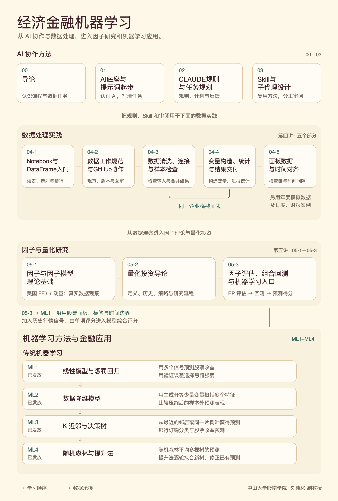

# 经济金融机器学习

中山大学岭南学院 · 刘晓彬 副教授

本目录收录 16 份 HTML 课件，按“AI协作方法 → 数据处理实践 → 因子与量化研究 → 机器学习方法与金融应用”组织。主课程包含00—03、04-1—04-5、05-1—05-3；机器学习阶段已发放 ML1 至 ML4。

[查看矢量关系图](assets/course-map-ml4-95872247.svg)

金色箭头表示学习顺序，青绿连线表示数据承接。第五讲05-3用EP评价股票排序；ML1沿用股票面板、收益标签和时间边界，加入动量、波动率与相对成交量，学习综合预测评分。规模与行业仅用于信号中性化。ML2 用模拟财务特征提取主成分，并比较降维方法的样本外预测表现。ML3 继续学习 K 近邻和决策树，用银行营销记录讲分类与联系阈值，用课程股票面板讲收益预测。ML4 在同一股票面板上比较随机森林与提升法，用平安银行的一条记录解释各树平均与逐轮更新。

| 课件 | 页数 |
| --- | ---: |
| [00-导论](00-导论.html) | 62 |
| [01-AI底座与提示词起步](01-AI底座与提示词起步.html) | 102 |
| [02-CLAUDE规则与任务规划](02-CLAUDE规则与任务规划.html) | 68 |
| [03-Skill与子代理设计](03-Skill与子代理设计.html) | 47 |
| [04-1-Notebook与DataFrame入门](04-1-Notebook与DataFrame入门.html) | 35 |
| [04-2-数据工作规范与GitHub协作](04-2-数据工作规范与GitHub协作.html) | 38 |
| [04-3-数据清洗连接与样本检查](04-3-数据清洗连接与样本检查.html) | 43 |
| [04-4-变量构造统计与结果交付](04-4-变量构造统计与结果交付.html) | 36 |
| [04-5-面板数据与时间对齐](04-5-面板数据与时间对齐.html) | 33 |
| [05-1-因子与因子模型理论基础](05-1-因子与因子模型理论基础.html) | 96 |
| [05-2-量化投资导论](05-2-量化投资导论.html) | 103 |
| [05-3-因子评估、组合回测与机器学习入口](05-3-因子评估组合回测与机器学习入口.html) | 156 |
| [ML1-线性模型与惩罚回归](ML1-线性模型与惩罚回归.html) | 70 |
| [ML2-数据降维模型](ML2-数据降维模型.html) | 52 |
| [ML3-K近邻与决策树](ML3-K近邻与决策树.html) | 76 |
| [ML4-随机森林与提升法](ML4-随机森林与提升法.html) | 80 |

下载仓库后打开 [index.html](index.html)，或单独打开 HTML；图示已内嵌。

文件命名统一为“讲次编号-主题-用途或版本”。HTML/PDF课件使用同一主题名；ZIP统一标注“配套材料”，并保留“含参考答案”“不含数据”等必要标识；交互网页统一标注“交互演示”。

## 配套材料

| 部分 | 下载与演示 |
| --- | --- |
| 04-3 | [参考答案包](04-3-数据清洗连接与样本检查-配套材料-含参考答案.zip) |
| 04-4 | [参考答案包](04-4-变量构造统计与结果交付-配套材料-含参考答案.zip) · [统计交互](04-4-变量构造统计与结果交付-交互演示.html) |
| 04-5 | [参考答案包](04-5-面板数据与时间对齐-配套材料-含参考答案.zip) · [面板交互](04-5-面板数据与时间对齐-交互演示.html) |
| 05-1 | [四因子观察学生材料包](05-1-因子与因子模型理论基础-配套材料.zip)（Notebook、真实数据、数据字典与运行说明） |
| 05-2 | [量化投资导论配套材料（不含数据，约1.18 MB）](05-2-量化投资导论-配套材料-不含数据.zip)（Notebook、工具代码、图表与数据说明；数据由教师另行提供） |
| 05-3 | [EP因子评估配套材料（不含数据，约103 KB）](05-3-因子评估组合回测与机器学习入口-配套材料-不含数据.zip)（Notebook、工具代码、示范图表、统计汇总与数据说明；输入数据由教师另行提供） · [因子评估交互演示](05-3-因子评估组合回测与机器学习入口-交互演示.html) |
| ML1 | [线性模型与惩罚回归配套材料（不含数据）](ML1-线性模型与惩罚回归-配套材料-不含数据.zip)（Notebook、课堂输出、图表、统计汇总与运行说明） · [交互演示](ML1-线性模型与惩罚回归-交互演示.html) |
| ML2 | [降维模拟 Notebook 与运行说明](ML2-数据降维模型-配套材料.zip) · [五个交互实验](ML2-数据降维模型-交互演示.html)（模拟数据由 Notebook 生成） |
| ML3 | [K 近邻与决策树配套材料](ML3-K近邻与决策树-配套材料-不含股票面板.zip)（含银行数据，股票面板由教师另发） · [交互演示](ML3-K近邻与决策树-交互演示.html) |
| ML4 | [随机森林与提升法配套材料](ML4-随机森林与提升法-配套材料-不含股票面板及逐股OOB.zip)（80 页 Notebook 阅读、实验和案例汇总） · [交互演示](ML4-随机森林与提升法-交互演示.html) |

解压后按包内README运行Notebook；04-4、04-5、05-3、ML1 至 ML4 的交互网页均已提供，可离线打开。课件图片已内嵌；首页课程关系图使用随仓库提供的 `assets/` 文件夹。05-2 ZIP不含输入数据，需将教师另行提供的六张精简Parquet表（约54.7 MB）放入包内 `data/offline/`，再运行Notebook。其他部分材料由教师另行提供。

05-1 使用 Kenneth R. French Data Library 的美国 FF3 与动量月度数据（1927-01—2026-08）；官方原始数据、来源地址与合并脚本随包提供。解压后打开 `05-1-课堂材料`，从 README 开始。05-2《量化投资导论》共 103 页，介绍量化投资的定义、发展历史、策略、A 股市场环境、行业版图、研究流程及案例；配套Notebook保留原内容与运行结果，提供不含数据的独立材料包。

05-3《因子评估、组合回测与机器学习入口》共156页，以EP为主案例，涵盖数据筛选、中性化、IC与ICIR、衰减、分组与回测、组合绩效及机器学习预测得分入口。图示已内嵌，配套Notebook及代码见上方不含数据包。解压后打开 `05-03-课堂材料`，按README将教师另行提供的数据包合并到同名目录，确认32个输入文件位于 `data/offline/`，再运行 `notebooks/05-03-EP因子评估与回测.ipynb`。

ML1《线性模型与惩罚回归》共70页，从EP评分进入个股收益预测，使用EP、动量、波动率和相对成交量共7个中性化信号比较OLS、Ridge、Lasso和Elastic Net。规模与行业仅用于中性化。课件区分训练损失、验证MSE与Rank IC，模型按不含惩罚项的验证MSE选参。

ML1公开包不含月度输入数据及全量逐股预测表；运行前需取得教师另行提供的课堂数据包，合并到“ML1-课堂材料”目录，并确认`data/ep_ml1_panel.parquet`存在。已有Notebook输出和交互示例可直接阅读，数值表与图表保留教学汇总及有限股票示例。

ML4 的课件和交互可直接离线打开。公开包可阅读 Notebook、查看保存的输出并运行模拟实验。完整复跑 19 个代码单元时，将教师提供的课堂数据包解压到同一位置，合并进 `ML4-课堂材料/` 目录，使股票面板位于 `data/ep_ml_panel.parquet`，逐股袋外预测位于 `output/forest-oob.parquet`。

## 课程声明与致谢

05-2《量化投资导论》署名：刘晓彬（中山大学岭南学院）、曾涛（浙江大学）。

本课件编写过程中参考了多位专家学者的意见，感谢他们的支持与建议。

## 许可协议

© 2026 刘晓彬。原创课件采用 [CC BY-NC-ND 4.0（署名—非商业性使用—禁止演绎）](https://creativecommons.org/licenses/by-nc-nd/4.0/)。

[LICENSE 全文](LICENSE) · [中文许可说明](许可协议.html)。第三方资料保留原作者和原有权利，本课件许可不替代其授权。
