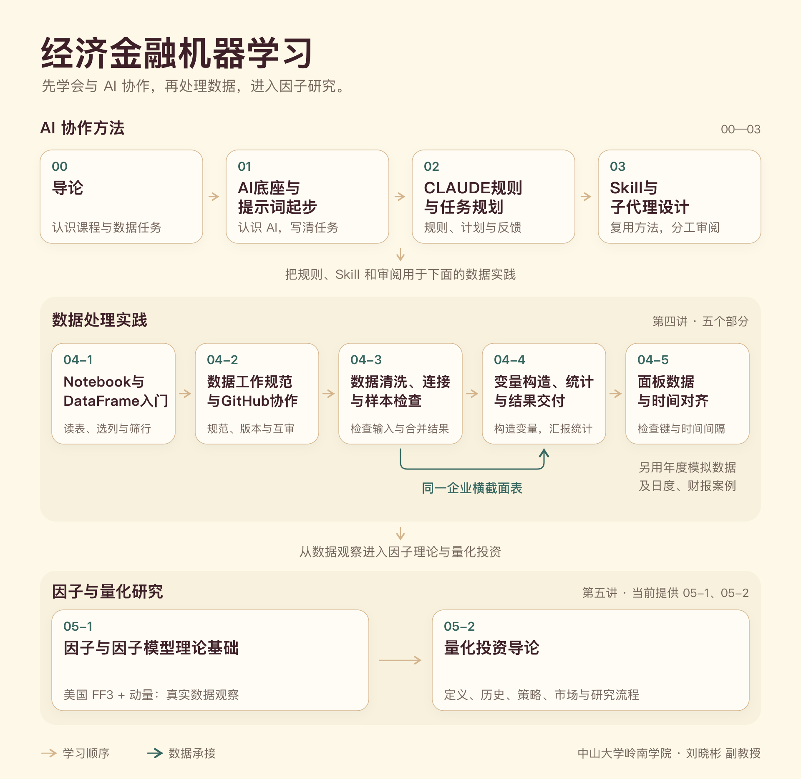

# 经济金融机器学习

中山大学岭南学院 · 刘晓彬 副教授

本仓库公开主课程 00、01、02、03、04-1、04-2、04-3、04-4、04-5、05-1、05-2 的 HTML 课件。

| 课件 | 页数 |
| --- | ---: |
| [00-导论](00-导论.html) | 62 |
| [01-AI底座与提示词起步](01-AI底座与提示词起步.html) | 102 |
| [02-CLAUDE规则与任务规划](02-CLAUDE规则与任务规划.html) | 68 |
| [03-Skill与子代理设计](03-Skill与子代理设计.html) | 47 |
| [04-GitHub与Python数据处理-1-Notebook与DataFrame入门](04-GitHub与Python数据处理-1-Notebook与DataFrame入门.html) | 35 |
| [04-GitHub与Python数据处理-2-数据工作规范与GitHub协作](04-GitHub与Python数据处理-2-数据工作规范与GitHub协作.html) | 38 |
| [04-GitHub与Python数据处理-3-数据清洗连接与样本检查](04-GitHub与Python数据处理-3-数据清洗连接与样本检查.html) | 43 |
| [04-GitHub与Python数据处理-4-变量构造统计与结果交付](04-GitHub与Python数据处理-4-变量构造统计与结果交付.html) | 36 |
| [04-GitHub与Python数据处理-5-面板数据与时间对齐](04-GitHub与Python数据处理-5-面板数据与时间对齐.html) | 33 |
| [05-1-因子与因子模型理论基础](05-1-因子与因子模型理论基础.html) | 96 |
| [05-2-中国量化历史与研究流程](05-2-中国量化历史与研究流程.html) | 103 |

下载仓库后打开 [index.html](index.html)，或单独打开 HTML；图示已内嵌。

## 配套材料

| 部分 | 下载与演示 |
| --- | --- |
| 04-3 | [参考答案包](04-GitHub与Python数据处理-3-数据清洗连接与样本检查-参考答案版.zip) |
| 04-4 | [参考答案包](04-GitHub与Python数据处理-4-变量构造统计与结果交付-参考答案版.zip) · [统计交互](04-4-统计交互网页.html) |
| 04-5 | [参考答案包](04-GitHub与Python数据处理-5-面板数据与时间对齐-参考答案版.zip) · [面板交互](04-5-面板键与年度匹配演示.html) |
| 05-1 | [四因子观察学生材料包](05-1-因子与因子模型理论基础-学生材料.zip)（Notebook、真实数据、数据字典与运行说明） |

解压后按包内README运行Notebook；交互网页可离线打开。其他部分材料由教师另行提供。

05-1 使用 Kenneth R. French Data Library 的美国 FF3 与动量月度数据（1927-01—2026-08）；官方原始数据、来源地址与合并脚本随包提供。解压后打开 `05-1-课堂材料`，从 README 开始。05-2 为历史与研究流程课件，无独立学生包。

## 课程声明与致谢

本课件编写过程中参考了多位专家学者的意见，感谢他们的支持与建议。

## 许可协议

© 2026 刘晓彬。原创课件采用 [CC BY-NC-ND 4.0（署名—非商业性使用—禁止演绎）](https://creativecommons.org/licenses/by-nc-nd/4.0/)。

[LICENSE 全文](LICENSE) · [中文许可说明](许可协议.html)。第三方资料保留原作者和原有权利，本课件许可不替代其授权。
